<p align="center">
  
</p>

<h1 align="center">AquariaWish - Pulls Tracker</h1>

<p align="center">
  <a href="LICENSE"></a>
  
  
  
  
  <br>
  <a href="https://github.com/douglaslins/aquariawish_py/commits/main"></a>
  <a href="https://github.com/douglaslins/aquariawish_py/issues"></a>
  <a href="https://github.com/douglaslins/aquariawish_py/pulls"></a>
</p>

<p align="center">
  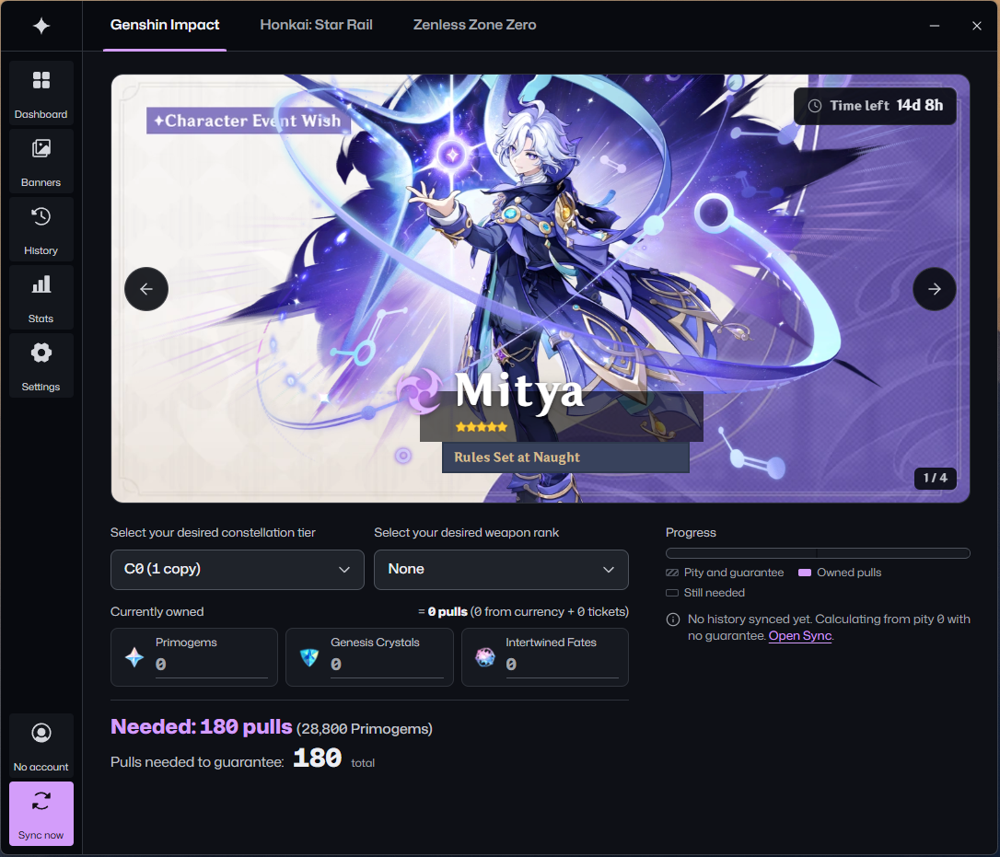<br/>
  <sub><b>Plan a character goal.</b> Pick a tier, enter owned currency, read the pulls still needed.</sub>
</p>

Desktop application that stores pull history (wishes, warps, signal searches) for Genshin Impact, Honkai: Star Rail and Zenless Zone Zero, and computes pity, guarantee state and statistics from it.

Unofficial fan project. Account sync has only run against a simulated service, not against live game servers ([details](docs/account-sync.md)).

Developed with Claude Sonnet 5.5, including this README. UI/UX and the logo banner designed by hand.

## Features

- **Track.** Stores pulls in a local SQLite database, keyed by game, UID and pull ID, for several accounts per game.
- **Sync.** Reads pull history from the game's history service with the link the game saves on the computer.
- **Import and export.** Imports UIGF v4.x JSON and this program's CSV. Exports UIGF v4.0 JSON and CSV.
- **Back up.** Copies the database before a sync, an account removal and an import that replaces pulls. Keeps the newest 10.
- **Pity and guarantee.** Computes pity, 50/50 or 75/25 guarantee state and the result of each 5-star from the stored pulls.
- **Statistics.** Average, best and worst pity, luck grade, pity distribution, 50/50 and 75/25 record, spend.
- **History.** Filters by banner, rarity, dates and name. Draws a 5-star timeline. Exports the filtered rows as CSV.
- **Goals.** Calculates the worst-case pulls for a character goal, a weapon goal or both, from pity, guarantee, owned currency and tickets.
- **Banners.** Shows current, upcoming and past banners with art from third-party services (see [Network access and APIs](#network-access-and-apis)).

Screenshots were taken on a fresh install with no account synced, so pity counters are 0.

<table>
  <tr>
    <td width="33%">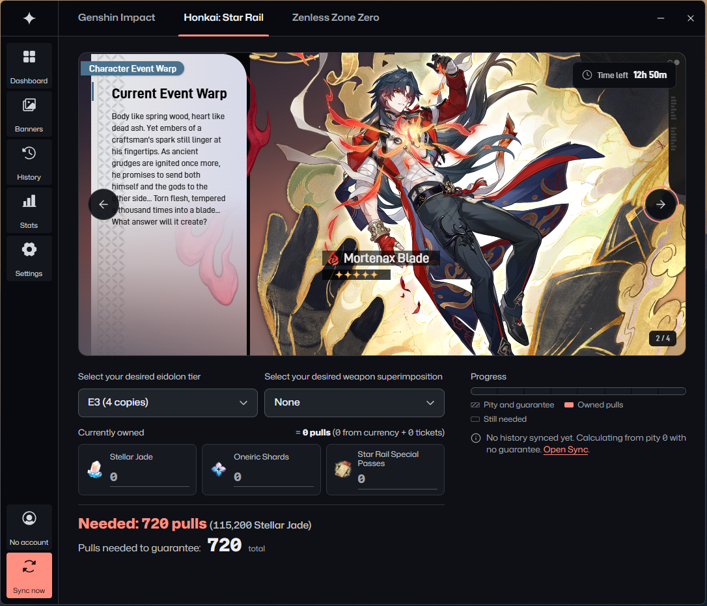<br/><sub><b>Honkai: Star Rail.</b> Eidolon and superimposition goals. Counts Stellar Jade, Oneiric Shards and Special Passes.</sub></td>
    <td width="33%">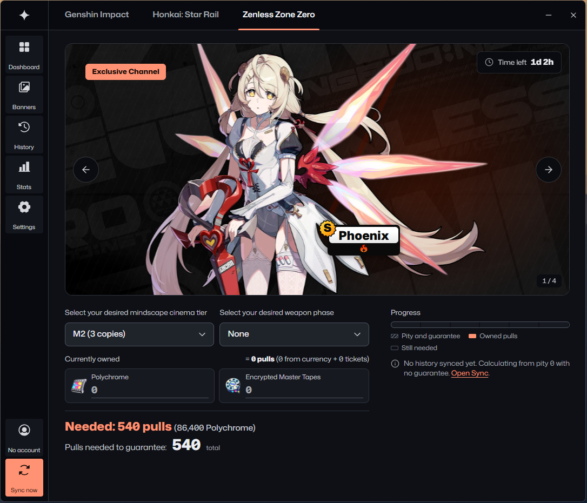<br/><sub><b>Zenless Zone Zero.</b> Mindscape cinema and weapon phase goals. Counts Polychrome and Master Tapes.</sub></td>
    <td width="33%">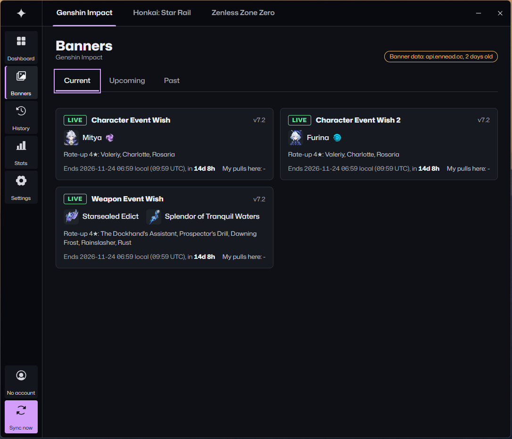<br/><sub><b>Live banners.</b> Featured items, rate-up 4-stars, end time and your pulls on each.</sub></td>
  </tr>
</table>

<details>
<summary>More screenshots</summary>

<table>
  <tr><td width="50%">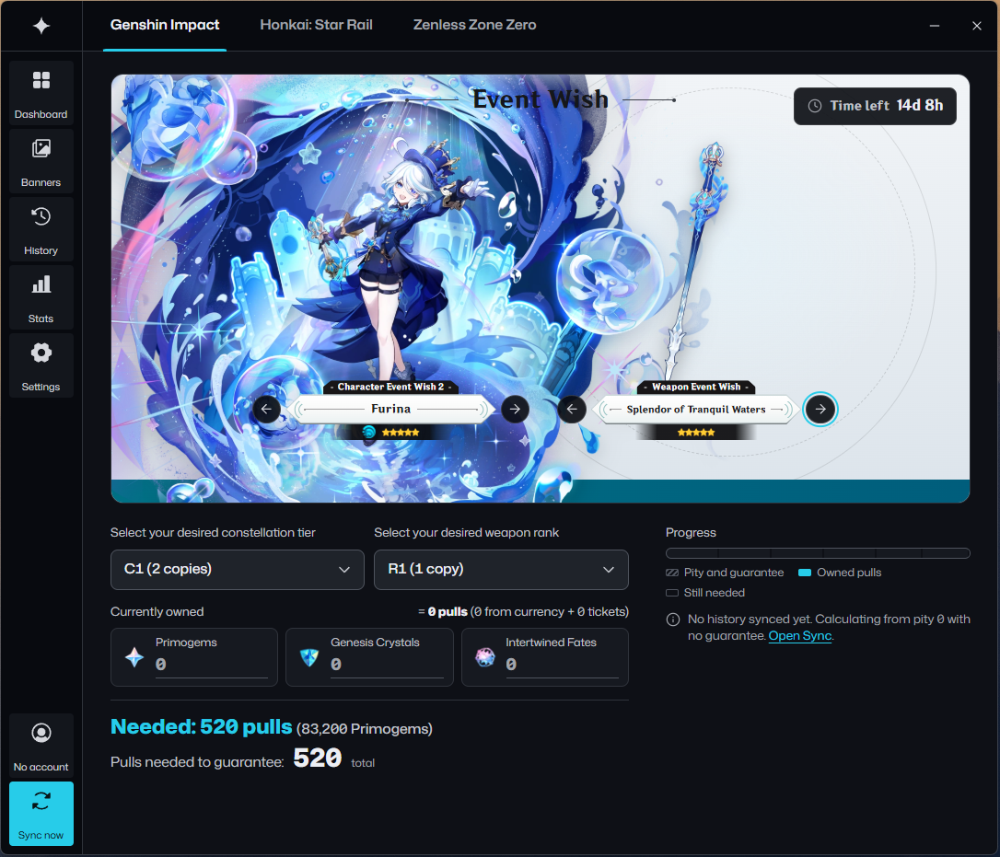<br/><sub><b>Plan a character and a weapon together.</b> Set both goals to total the pulls for both banners.</sub></td><td width="50%">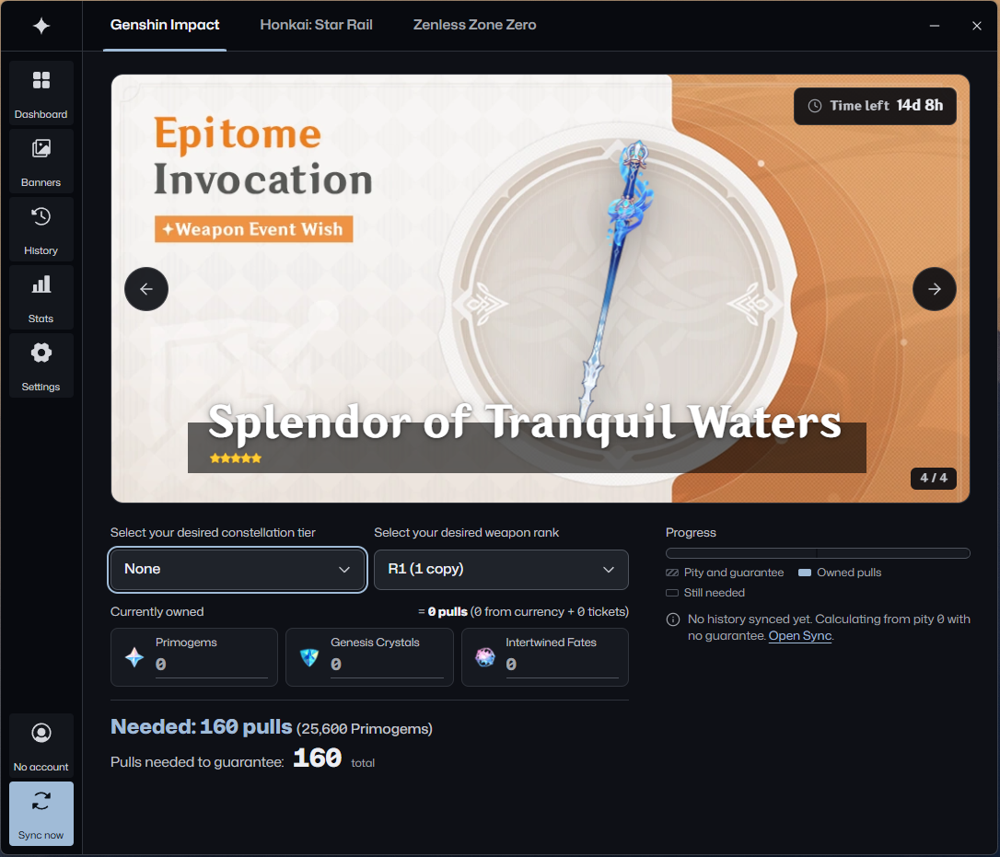<br/><sub><b>Plan a weapon alone.</b> Set the character goal to None.</sub></td></tr>
  <tr><td width="50%">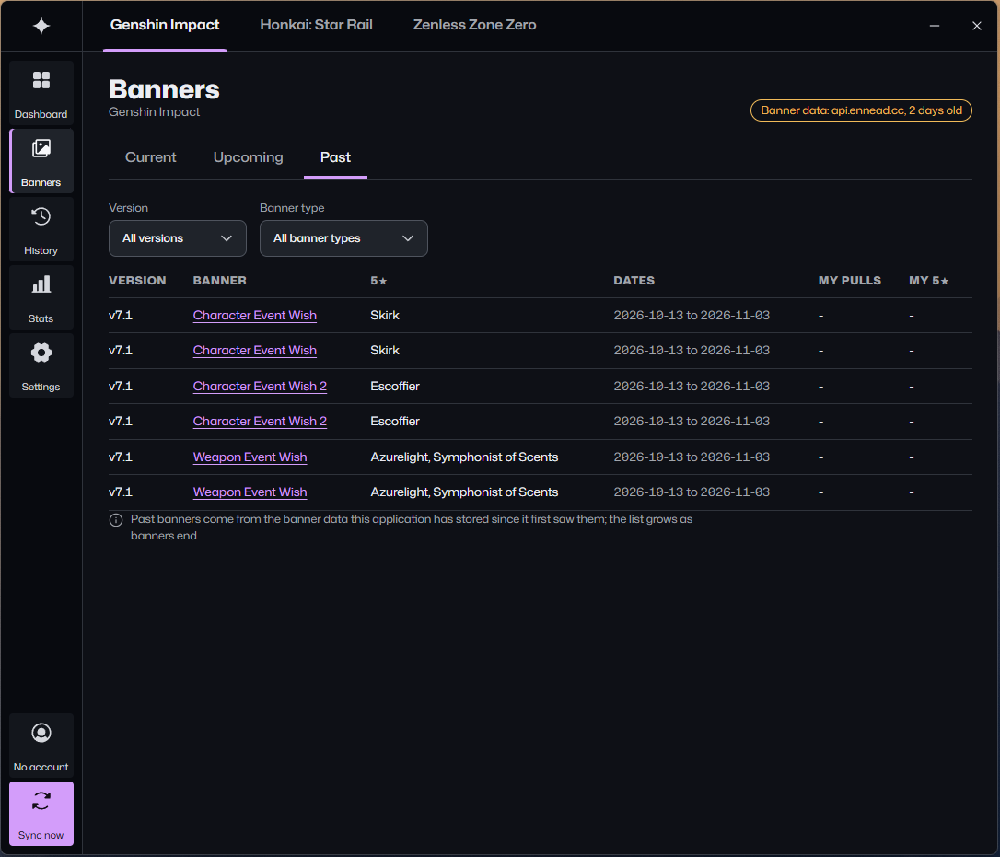<br/><sub><b>Past banners.</b> Filter by version and banner type.</sub></td><td width="50%">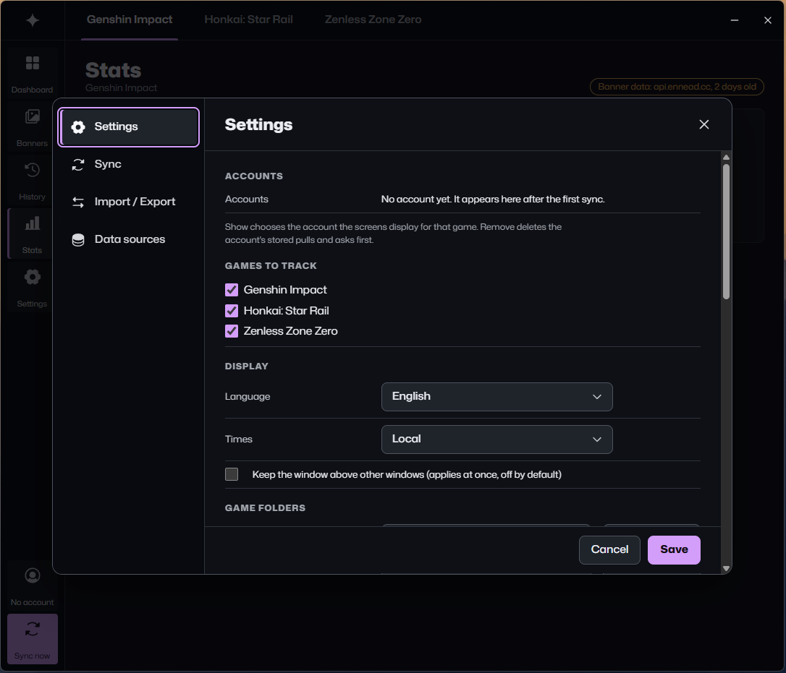<br/><sub><b>Settings.</b> Games to track, language, time zone, game folders.</sub></td></tr>
  <tr><td width="50%">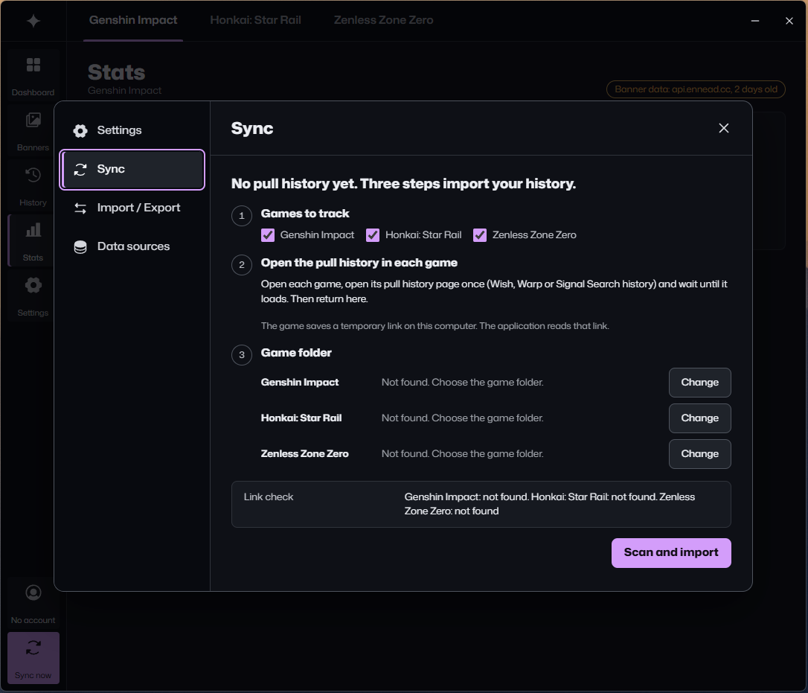<br/><sub><b>Sync.</b> The link check shows per game whether a saved history link was found.</sub></td><td width="50%">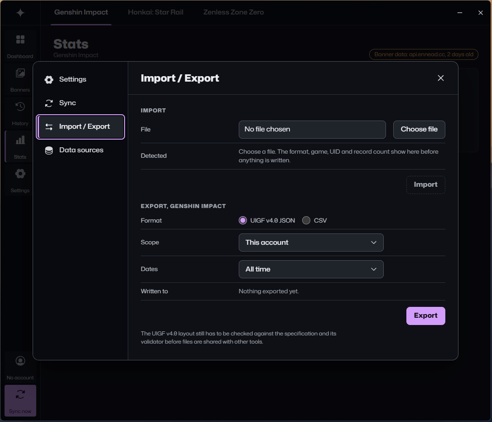<br/><sub><b>Import / Export.</b> UIGF v4.0 JSON or CSV. A preview shows format, game, UID and record count before import.</sub></td></tr>
  <tr><td width="50%">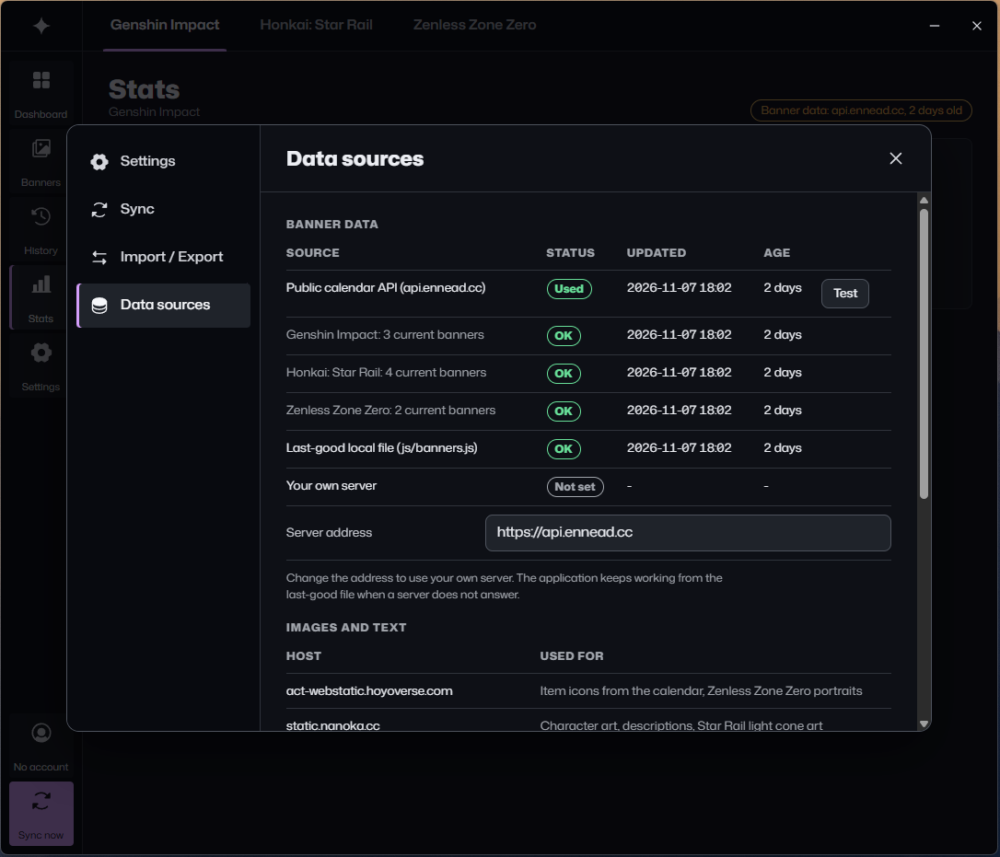<br/><sub><b>Data sources.</b> Status and age of each banner source. Test queries it. Server address replaces it.</sub></td></tr>
</table>

</details>

## Install

Requires Python 3.9 or newer, and Windows 10 or 11 with the Microsoft Edge WebView2 runtime (included in Windows 11 and in updated Windows 10).

```bash
pip install -r requirements.txt
python pulls_tracker.py
```

`requirements.txt` installs pywebview 6 and, on Windows, `keyring`, which stores the optional HoYoLAB cookie in Windows Credential Manager.

## Usage

To sync pulls:

1. Open each game, open its pull history page once (Wish, Warp or Signal Search history) and wait until it loads. The game saves a temporary history link on this computer. A link older than about a day is probably expired.
2. In the program, click **Sync now**. For any game that shows "Not found" under Game folder, click **Change** and choose the game folder.
3. Click **Scan and import**. After the first sync, **Sync now** syncs directly.

Everything the program writes goes to `data/` next to the program. The environment variable `PULLS_TRACKER_DATA` sets another folder.

Options of `pulls_tracker.py` and `AquariaWish.exe`:

- `--debug` enables the developer tools of the window (F12).
- `--perf` writes responsiveness measurements to `data/pulls_tracker.log`.
- `--selfcheck` checks folders, interface files, modules and WebView2, writes `data/selfcheck.txt` and exits.

## Network access and APIs

The program sends HTTP GET requests to the hosts below. It has no analytics or telemetry and uploads no pulls, accounts or database files.

| Host | Used for |
|---|---|
| `api.ennead.cc` | Current banners of the three games, at start. The address can be changed in Settings > Data sources. |
| `public-operation-hk4e-sg.hoyoverse.com`, `public-operation-hk4e.mihoyo.com` | Genshin Impact pull history. |
| `public-operation-hkrpg-sg.hoyoverse.com`, `public-operation-hkrpg.mihoyo.com` | Honkai: Star Rail pull history. |
| `public-operation-nap-sg.hoyoverse.com`, `public-operation-nap.mihoyo.com` | Zenless Zone Zero pull history. |
| `act-webstatic.hoyoverse.com` | Item icons, Zenless Zone Zero portraits. |
| `static.nanoka.cc` | Character art, descriptions, Star Rail light cone art. |
| `enka.network` | Character and weapon art. |
| `gi.yatta.moe` | Genshin weapon art. |
| `raw.githubusercontent.com` | Genshin character titles (genshin-db repository). |
| `cdn.prydwen.gg` | Zenless Zone Zero character art (a fan site's CDN). |

- History requests carry the saved link key (`authkey`) and go only to hosts under `hoyoverse.com`, `mihoyo.com` or `hoyolab.com`. Details: [Privacy and data](docs/privacy-and-data.md).
- When a host does not answer, the program uses the last-good banner file.
- Only the `hoyoverse.com` and `mihoyo.com` hosts are official. The others are third-party services.

## Build and test

Windows, 64-bit Python 3.10 to 3.13.

```bash
build_exe.bat
```

The script creates `.venv-build`, builds `dist/AquariaWish - Pulls Tracker/`, copies `README.txt`, `LICENSE.txt`, `THIRD_PARTY_NOTICES.md` and `AquariaWish.exe.config` next to the program, and runs `--selfcheck`. `./build_exe.sh` makes the same build on Linux and macOS for testing. Details: [docs/packaging.md](docs/packaging.md).

```bash
python -m unittest discover -s tests
```

`tests/test_ui_pages.py` needs Playwright and is skipped without it.

## Known limitations

- The UIGF v4.0 export has not been checked with the official validator.
- The game folder search reads Windows paths under `%USERPROFILE%\AppData\LocalLow`. Elsewhere, set the game folder in Settings.
- The pity of the first stored 5-star of a banner type is a lower bound (`≥`), because the servers keep a limited history.
- Epitomized Path and selected Bangboo are not in the pull history, so neither is shown. The Capturing Radiance counter is an estimate.
- The HoYoLAB cookie field in Settings stores a value that no feature uses yet.
- `AquariaWish.exe` is unsigned. Windows SmartScreen shows "Windows protected your PC" at the first start: click More info, then Run anyway.

## Documentation

- [Start-up, loading panel and window behavior](docs/startup.md)
- [Pulls, pity and statistics](docs/pulls-and-statistics.md)
- [Account sync](docs/account-sync.md)
- [Privacy and data](docs/privacy-and-data.md)
- [Packaging the .exe](docs/packaging.md)
- [File layout](docs/files.md)
- [Interface (HTML, CSS, JS)](pulls_tracker_ui/README.md)
- [Audit changes](AUDIT_CHANGES.md)

## License and legal

- The program's code, documentation and logo banner (drawn by hand) are under the [MIT License](LICENSE). Third-party software, fonts, icons and data keep their licenses: [THIRD_PARTY_NOTICES.md](THIRD_PARTY_NOTICES.md).
- Game content and materials are trademarks and copyrights of their respective publisher and its licensors. Genshin Impact, Honkai: Star Rail and Zenless Zone Zero: © All rights reserved by miHoYo. © COGNOSPHERE. All rights reserved. "HoYoverse" is a trademark of COGNOSPHERE PTE. LTD.
- Other properties and any right, title, and interest thereof and therein (intellectual property rights included) not derived from these games belong to their respective owners.
- As fan wikis do, the project claims no license for the game images, including those in the screenshots. It asserts fair use or the equivalent exception under applicable law. HoYoverse has not licensed or approved this. To have a file removed, open an issue.
- Not affiliated with or endorsed by HoYoverse. The author understands that a program with no in-game advantage is within HoYoverse's rules on third-party tools. HoYoverse has not confirmed this. Use it at your own risk.
